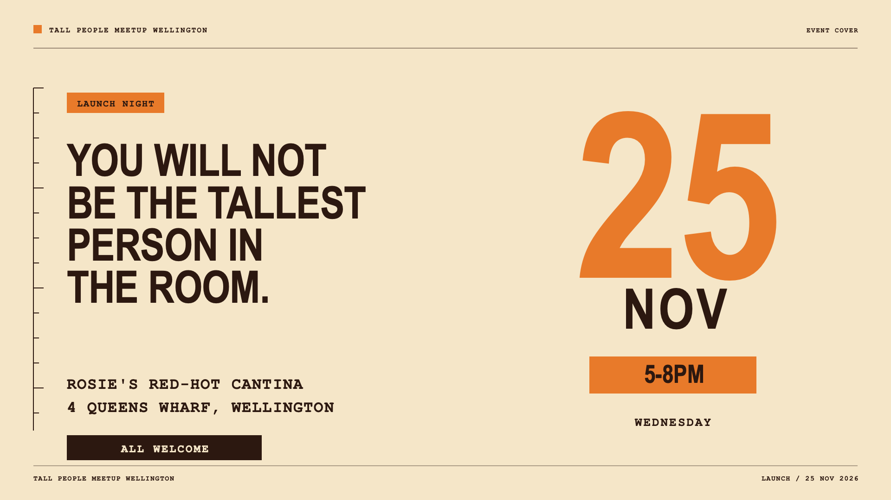
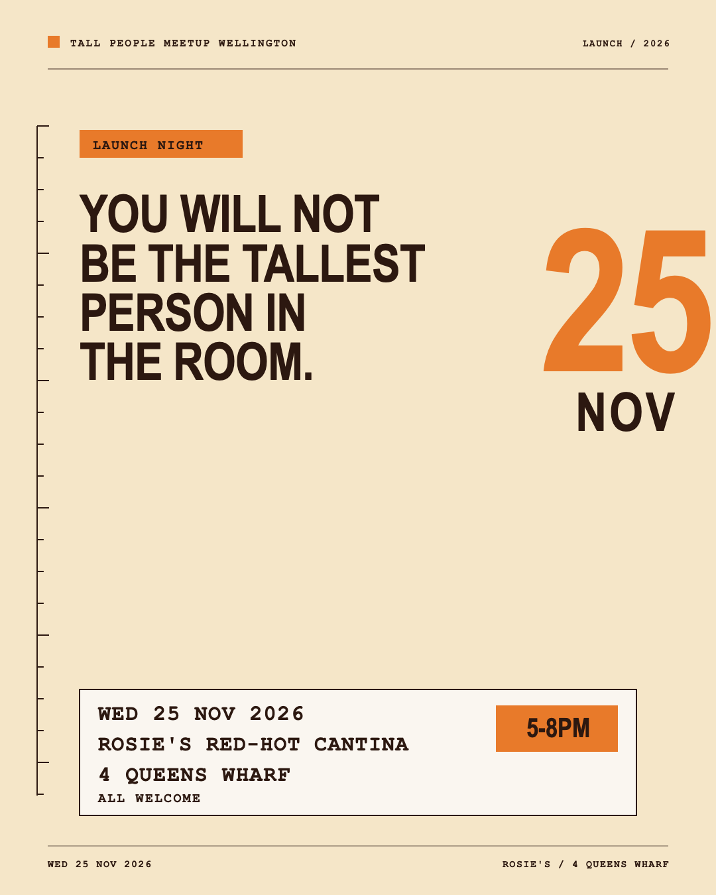
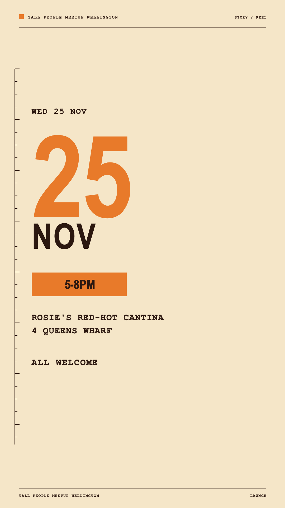

# Tall People Meetup Wellington launch kit

Event: Wednesday 25 November 2026, 5pm to 8pm, Rosie's Red-Hot Cantina, 4 Queens Wharf.

## Start here

- [100-item run sheet](https://docs.google.com/document/d/1pkksCWZSezYyTvtR5bKaqMsKa4mFcmn5xcXRCQNcnzw/edit) covers the night before, setup, the event and follow-up.
- [Brand brief](brand-brief.md) explains the visual system and the anti-AI rules.
- [Copy pack](copy.md) has the Facebook page text, captions, story text, and DMs.
- [Schedule](schedule.md) gives you 2 to 3 posts per day from 20 to 26 November.
- [Reel scripts](reel-scripts.md) gives you phone-shot scripts for the Reels.
- [Twenty design directions](moodboards/moodboards.md) is the visual shortlist. Open `moodboards/index.html` to compare them.
- [Facebook page build sheet](facebook-page.md) fills in every field the page and event ask for.
- [Coline's club email](outreach/coline-club-email.md) is the draft for reaching basketball, netball and volleyball clubs.
- [Skill review](skill-review.md) records the `judge-repo` check.
- [DESIGN.md](DESIGN.md) is the design system, written for a person and for an agent.
- [Penpot notes](PENPOT.md) cover importing the tokens and the SVGs.
- [Design asset shelf](design-assets.md) lists the open-licence icon, type and colour repos worth using.
- [Tokens](tokens/tokens.json) holds twenty palettes in W3C format.
- [Photos](photos/sources.json) records the public domain and CC0 images and their licences.
- [Moodboard systems](systems/README.md) has twenty eras, three pages each, all on the Memphis photo-led layout.
- [Contact sheet](systems/contact-sheet.png) shows all sixty boards in one image.

The existing event cover is the brand. Everything else in the kit now has to agree with it rather than compete with it.

The `assets/png` folder is ready to upload. The `assets/svg` folder is the editable source. Open the SVGs in Figma, Illustrator, or Affinity Designer. Text stays live.

## Preview

## What is in the kit

Facebook:

- `assets/png/fb-event-cover.png`
- `assets/png/fb-page-cover.png`
- `assets/png/fb-profile.png`

Instagram feed:

- `assets/png/ig-feed-01-announce.png`
- `assets/png/ig-feed-02-first.png`
- `assets/png/ig-feed-03-mates.png`
- `assets/png/ig-feed-04-venue.png`
- `assets/png/ig-feed-05-tomorrow.png`
- `assets/png/ig-feed-06-today.png`
- `assets/png/ig-feed-07-recap.png`

Instagram stories and Reel covers:

- `assets/png/ig-story-01-announce.png`
- `assets/png/ig-story-02-mates.png`
- `assets/png/ig-story-03-venue.png`
- `assets/png/ig-story-04-tomorrow.png`
- `assets/png/ig-story-05-today.png`
- `assets/png/ig-story-06-here.png`
- `assets/png/ig-story-07-thanks.png`

## Use the kit

1. Fix the Facebook event end time.
2. Upload the profile and page cover.
3. Update the page About and Instagram bio.
4. Post the launch feed image on 20 November.
5. Follow the schedule.
6. Use real phone footage for the Reels. Do not use AI faces or stock video.
7. After the event, add one real photo to the recap template if you have one.

## Edit the design

Open the SVG, not the PNG. Change the text, keep the left rule, keep one amber accent, keep the hard edges. Export at the listed size.

If the fonts do not load on another machine, replace Arial Narrow with Archivo Narrow and Courier New with IBM Plex Mono. Do not convert text to outlines until the final export.

## What to avoid

Do not add gradients, glass cards, 3D shapes, generic icons, stock smiling groups, or a giraffe mascot. Do not add more colours. Do not add an em dash. Do not rewrite the copy into motivational language.

The campaign works because it looks like a notice for a real night at a real pub. Keep it that way.
